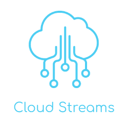
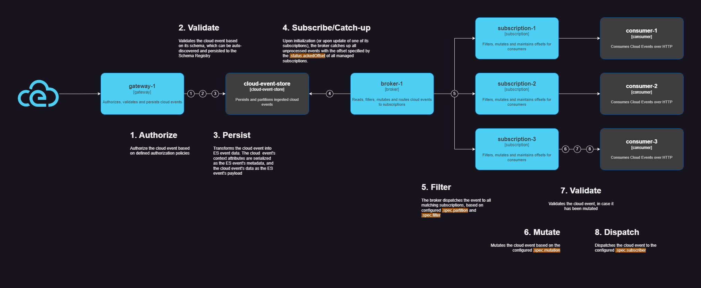

<p align="center">
  
</p>
<hr>

## Contents

- [About](#about)
	+ [Features](#features)
	+ [Benefits](#benefits)
- [Documentation](#documentation)
	+ [Fundamentals](#fundamentals)
	+ [Getting started](#getting-started)
	+ [Delivery and retries](#delivery-and-retries)
	+ [Authentication](#authentication)
	+ [Retention](#retention)
	+ [Monitoring](#monitoring)
	+ [API Reference](#api-reference)
- [Contributing](#contributing)
	+ [How to contribute](#how-to-contribute)
	+ [Types of contributions](#types-of-contributions)
	+ [Code of conduct](#CODE_OF_CONDUCT)
	+ [Get in touch](#get-in-touch)
	+ [Let's build together](#lets-build-together)
## About

Cloud Streams is a cloud-native tool that empowers users to capture and process [cloud events](https://cloudevents.io/) in real-time, enabling event-driven architectures that are both scalable and efficient. With Cloud Streams, you can customize how you stream, filter, partition, and mutate the [cloud events](https://cloudevents.io/) you consume using declarative rules, giving you full control over how your data is processed and consumed.

As event-driven architectures have become more popular, so too have the challenges associated with building and managing them, especially when dealing with large volumes of data. This is where Cloud Streams comes in. This powerful and straightforward tool provides a simple and effective way to capture, process, and route cloud events in real-time, allowing you to create event-driven architectures that are both flexible and reliable.

### Features

- **Streaming**: Cloud Streams allows users to stream cloud events in real-time, ensuring that all relevant data is captured and processed as soon as it becomes available. This feature is especially useful for applications that require real-time data processing, such as financial trading or IoT applications.
- **Filtering**: Cloud Streams provides powerful filtering capabilities, allowing users to filter cloud events based on declarative rules. This ensures that only relevant data is captured and processed, reducing processing time and improving overall system performance.
- **Persistence**: Cloud Streams ensures that all consumed cloud events are persisted, guaranteeing that data is not lost and will eventually be delivered to the appropriate consumers. This feature is especially useful for mission-critical applications where data loss is not acceptable.
- **Routing**: Cloud Streams provides flexible routing capabilities, allowing users to route cloud events based on declarative rules. This ensures that data is sent to the correct consumers, reducing data processing errors and improving system efficiency.
- **Mutations**: Cloud Streams offers the capability to modify incoming events prior to sending them to subscribers, which allows for backward compatibility and the ability to remove or transform sensitive data.
- **Fault Tolerance**: Cloud Streams provides fault tolerance by implementing atomic, configurable retry policies that enable brokers to resend missed events to a consumer that was previously unavailable or that responded with a non-success status code. This ensures that all missed events are eventually received by the consumer in the order they were originally posted. The retry policy enables potential errors to be fixed at the consumer level, without the risk of losing data.
- **Playback**: Cloud Streams provides playback capabilities, allowing users to play back previously captured cloud events. This can be useful for debugging, testing, or catastrophic recovery purposes. With this feature, users can recover from system failures or data corruption by replaying previously captured events.

### Benefits

- **Scalability**: Cloud Streams is designed to be highly scalable, allowing users to process large volumes of data with ease. This makes it an ideal solution for applications with rapidly changing data requirements.
- **Flexibility**: Cloud Streams provides flexible filtering and routing capabilities, allowing users to customize the way their data is processed and consumed. This ensures that users can adapt to changing data requirements quickly and easily.
- **Efficiency**: Cloud Streams' filtering and routing capabilities improve data processing efficiency, reducing the time and resources required to process data. This can lead to significant cost savings over time.
- **Reliability**: Cloud Streams is designed to be highly reliable, ensuring that data is captured, processed, and consumed accurately and efficiently. This makes it an ideal solution for mission-critical applications.
- **Historical Data Access**: Cloud Streams provides historical data access capabilities, allowing users to access previously captured cloud events. This can be useful for analyzing historical data, as well as for replaying events for debugging, testing, or catastrophic recovery purposes. With this feature, users can recover from system failures or data corruption by accessing previously captured events.
- **Easy to Integrate**: Cloud Streams is extremely easy to integrate in existing solutions. As a matter of fact, producers can publish events to Cloud Streams simply by POSTing Cloud Events, using the [structured content mode](https://github.com/cloudevents/spec/blob/v1.0.2/cloudevents/bindings/http-protocol-binding.md#32-structured-content-mode), to a specific gateway. Consumers, on the other hand, only need to have an endpoint that can accept cloud events sent over HTTP using the [structured content mode](https://github.com/cloudevents/spec/blob/v1.0.2/cloudevents/bindings/http-protocol-binding.md#32-structured-content-mode). That's it. All the configuration, and control, is offloaded to Cloud Streams resources such as subscriptions.

### Want to know more?

Then take a look at our [wiki](https://github.com/neuroglia-io/cloud-streams/wiki)📚, or start a new discussion/issue!

<hr>

*Solution overview:*



## Documentation

### Fundamentals

CloudStreams is a platform that implements [resource-oriented architecture (ROA)](https://github.com/neuroglia-io/cloud-streams/wiki/Fundamentals#resources) to allow users to customize the behavior and configuration of event processing. Similar to Kubernetes Custom Resources, CloudStreams resources enable users to define specific configurations without modifying the underlying system. These resources serve as templates for various aspects of event handling within the CloudStreams ecosystem, offering flexibility to tailor event processing to specific architectural needs.

[Cloud Events](https://github.com/neuroglia-io/cloud-streams/wiki/Fundamentals#cloud-events) are a standardized format used by CloudStreams to represent events in cloud environments. They encapsulate essential information about an event, such as its type, source, and data, fostering interoperability and seamless integration across different cloud services.

[Streams](https://github.com/neuroglia-io/cloud-streams/wiki/Fundamentals#streams) in CloudStreams are ordered, append-only collections of events, providing comprehensive auditing and enabling efficient event handling. Events are automatically [partitioned](https://github.com/neuroglia-io/cloud-streams/wiki/Fundamentals#partitions) based on attributes like source, type, and subject, allowing for scalable and responsive architectures.

CloudStreams [subscriptions](https://github.com/neuroglia-io/cloud-streams/wiki/Fundamentals#subscriptions) empower users to configure event dispatching based on partitions, filters, and mutations. This fine-grained control optimizes event-driven applications by ensuring that relevant events are efficiently processed and delivered to consumers based on specific criteria.

*Please view the [wiki](https://github.com/neuroglia-io/cloud-streams/wiki/Fundamentals)📚 for additional information.*

### Getting started

The easiest way to start the solution is using Docker Compose.

To do this, clone the repository:

```shell
git clone https://github.com/neuroglia-io/cloud-streams.git
```

Navigate to the resulting `/cloud-streams/` directory, then run the following command:

```shell
docker compose -f "deployments/docker-compose/docker-compose.yml" up --build
```

This development stack authenticates nothing, and runs EventStoreDB without TLS. To run it secured, add the secure overlay:
- EventStoreDB runs over TLS, with certificates generated on first start, and requires credentials.
- Users sign in to the dashboard through Keycloak, at `http://localhost:8180`, as the `demo` user.
- Publishers must send an `X-Api-Key` header.

The overlay reads its secrets from the environment, and never stores them in the repository:

```shell
export EVENTSTORE_ADMIN_PASSWORD=... KEYCLOAK_ADMIN_PASSWORD=... CLOUDSTREAMS_DEMO_PASSWORD=... CLOUDSTREAMS_INGESTION_API_KEY=...
docker compose -f "deployments/docker-compose/docker-compose.yml" -f "deployments/docker-compose/docker-compose.secure.yml" up --build
```

#### Kubernetes

A Helm chart, published with every release, deploys gateways and brokers. EventStoreDB and Redis are not part of it: point it at existing ones.

```shell
helm install cloud-streams oci://ghcr.io/neuroglia-io/charts/cloud-streams --version <release> \
  --set eventstore.connectionString='esdb://eventstore:2113?tls=false' \
  --set redis.connectionString='redis:6379' \
  --set gateway.managementApi.port=8081
```

- **Defaults:** 2 replicas of each, non-root containers listening on 8080, pod disruption budgets, and probes on `/healthz/live` and `/healthz`.
- **Connection strings:** they are kept in a secret. Pass `eventstore.existingSecret` and `redis.existingSecret` to use secrets of your own instead.
- **Management API:** `gateway.managementApi.port` serves the management API and the dashboard on a port of their own. `gateway.ingress` then exposes only the public endpoints, and `gateway.managementIngress` exposes the management port, e.g. on an internal ingress class.
- **Retention:** `retention.maxAge` and `retention.maxCount` set the policy described under [Retention](#retention).
- **Other settings**, such as authentication, are environment variables, set with `gateway.env` and `broker.env`, e.g. `{ name: Authentication__Dashboard__Enabled, value: "true" }`.

See [values.yaml](deployments/helm/cloud-streams/values.yaml) for every setting.

Now that everything is up and running, you can start publishing cloud events using POST requests on the gateway's ingestion endpoint, at `http://localhost:8080/api/events/pub`:

```shell
curl -X 'POST' \
  'http://localhost:8080/api/events/pub' \
  -H 'accept: */*' \
  -H 'Content-Type: application/cloudevents+json' \
  -d '{
  "id": "1234567890",
  "specversion": "1.0",
  "source": "https://foo.bar.com",
  "type": "bar.foo",
  "subject": "foobar",
  "dataschema": "string",
  "data": {
    "foo": "bar"
  }
}'
```

You can start consuming cloud events by creating a new subscription, which can be done via [Dashboard](http://localhost:8080/subscriptions), or by executing a simple POST request:

```shell
curl -X 'POST' \
  'http://localhost:8080/api/resources/v1/subscriptions?dryRun=false' \
  -H 'accept: text/plain' \
  -H 'Content-Type: text/json' \
  -d '{
  "metadata": {
    "name": "my-subscription"
  },
  "spec": {
    "subscriber": {
      "uri": "https://webhook.site/00000000-0000-0000-0000-000000000000"
    },
	"stream":{
	  "offset": 0
	}
  }
}'
``` 

The preceeding sample creates a new subscription to all events (no partition has been defined and no filter has been set). Because we have defined the stream offset at '0', when will start receiving all events ever published, even the ones published before the creation of the subscription. 

Note that, by default, subscriptions will only process cloud events published **after** their creation.

*For more information on subscriptions, please check the [wiki](https://github.com/neuroglia-io/cloud-streams/wiki/Fundamentals#subscriptions)📚.*

<hr>

The `Dashboard UI` is served by the `gateway` and is reachable at [http://localhost:8080](http://localhost:8080/).

The `Swagger UI`, also served by the `gateway`, is reachable at [http://localhost:8080/api/doc](http://localhost:8080/api/doc).

### Delivery and retries

The broker delivers each event with a `POST` to `spec.subscriber.uri`. Any `2xx` response acknowledges the event. For a subscription that tracks a stream offset, the broker then commits `status.stream.ackedOffset` (the offset of the *next* event to deliver) and moves on. Offsets are only committed after a successful delivery, so delivery is **at-least-once**: subscribers should be idempotent.

A delivery fails when the subscriber cannot be reached, responds with a non-success status code, or does not respond within the dispatch timeout. A subscription's mutation is applied by every delivery attempt: a mutation webhook shares the attempt's timeout, and its failures are retried like the subscriber's. Failed deliveries are retried according to `spec.subscriber.retryPolicy`. If the subscription has none, the broker's `spec.dispatch.retryPolicy` applies:

```yaml
spec:
  subscriber:
    uri: https://subscriber.example.com/events
    timeout: PT30S                # per attempt; defaults to the broker's spec.dispatch.timeout, or PT100S
    rateLimit: 10                 # optional maximum number of deliveries per second; must be strictly positive
    retryPolicy:
      statusCodes: [ 429, 503 ]   # status codes to retry; all of them if empty. Connection failures and timeouts are always retried
      backoffDuration:
        type: exponential         # constant | incremental | exponential
        period: PT1S
        exponent: 2
        maxDelay: PT5M            # caps the delay between two attempts; defaults to PT1H
      maxAttempts: 10             # defaults to 5; set to -1 to retry forever
      circuitBreaker:
        breakAfter: 3             # consecutive failures after which delivery pauses...
        breakDuration: PT30S      # ...for this long
```

While a delivery is being retried, the subscriber is reported `unreachable` in `status.subscriber`, and every failed attempt increments the `cloud_streams_broker_delivery_failures_count` metric. The event is never skipped. If the retry policy is exhausted, or the subscriber responds with a status code the policy does not retry, the subscription is faulted (`status.stream.fault`) with a message explaining how to resume, and the offset of the failed event is recorded in `status.stream.faultedOffset`. Resuming the subscription retries the event. `POST /api/resources/v1/subscriptions/{name}/skip?offset={faultedOffset}` skips it: it requires the operator role, and returns `409` if the subscription isn't faulted by that event. Setting `spec.stream.offset` to the failed event's offset, or to the next one, does the same. Subscriptions that do not track a stream offset drop the event instead, and carry on, unless they have a dead-letter policy.

#### Dead letters

A subscription with a dead-letter policy sets aside the events it fails to deliver, rather than being faulted or dropping them. That's once the retry policy is exhausted, or when the subscriber responds with a status code the policy doesn't retry. Delivery then carries on with the next event.

```yaml
spec:
  deadLetter: {}                                   # dead letters are stored in the subscription's dead-letter stream
  # deadLetter:
  #   uri: https://dead-letters.example.com        # or sent there, as structured cloud events
```

- **Dead-letter stream:** each dead letter records:
  - the event, as it was sent to the subscriber, so mutated if the subscription mutates events;
  - its offset;
  - the reason it couldn't be delivered;
  - when it was dead-lettered.
- **Dead-letter service:** the event is sent with the `cloudstreams-subscription` and `cloudstreams-offset` headers, and the reason, percent-encoded, in `cloudstreams-dead-letter-reason`. The service may itself be another Cloud Streams gateway's ingestion endpoint.
- **If dead-lettering fails:** the subscription is faulted, as it would be without a policy, and the event isn't skipped.
- **Metric:** dead-lettered events are counted by `cloud_streams_broker_dead_letters_count`.

Dead letters are browsed and redelivered with:

```
GET  /api/resources/v1/subscriptions/{name}/dead-letters?offset=&length=&direction=   # most recent first by default
POST /api/resources/v1/subscriptions/{name}/dead-letters/{offset}/redeliver           # requires the operator role
```

A redelivery posts the dead letter to the subscriber once, without an acknowledgement token. It answers `502 Bad Gateway` with the subscriber's response if the subscriber refuses it again. The dead-letter stream is a log: redelivering a dead letter doesn't remove it.

#### Replay

Operators replay a subscription with `POST /api/resources/v1/subscriptions/{name}/replay`. The subscription delivers every matching event again, from the start of the stream, or from a point in time:

```
POST /api/resources/v1/subscriptions/{name}/replay?from=2026-11-25T10:00:00Z
```

- **What the time resolves to:** the first event recorded at or after it, in the stream or partition the subscription consumes. If there's none, it resolves to the next event to be published.
- **Which time is used:** the time at which the gateway recorded the event, which never decreases along the stream, rather than the event's `time` attribute, which its publisher sets.
- **Reading the stream:** reads accept `time` instead of `offset` too. Reading forwards starts at the first event recorded at or after it, and reading backwards at the last one recorded before it. Records carry their `timestamp`.

#### Batches and parallel delivery

By default, a subscription delivers one event at a time, in the order of its stream, which caps its throughput at one round trip per event. Two opt-in modes raise it. They can't be combined.

```yaml
spec:
  subscriber:
    uri: https://subscriber.example.com
    batch:                    # delivers events in batches, as application/cloudevents-batch+json
      maxSize: 100
      linger: PT0.5S          # how long a partial batch waits to fill once the subscription has caught up. Defaults to none
    # ordering:               # or delivers events in parallel, in order per key
    #   key: subject          # the context attribute events are ordered by. Events that don't define it share a key
    #   maxConcurrency: 8     # how many keys are delivered concurrently
```

**How delivery works in these modes:**
- **Reading:** the broker reads what it delivers from the store, a page at a time.
- **Batches:** a page is one batch. The batch carries the offset of its first event in the `cloudstreams-offset` header, and the subscription's rate limit applies per request.
- **Ordering by key:** within a page, events that share a key are delivered one at a time, in order, while different keys are delivered concurrently.

**Offsets and failures:**
- **Committing:** a page's offset is only committed once every event of the page has been delivered, dead-lettered or filtered out. The committed offset never moves past an event that hasn't been delivered.
- **After a crash or a fault:** the page is redelivered from its start. Delivery remains at-least-once, but events of other keys may be delivered twice.
- **Failed batches:** a batch that fails for good is delivered again one event at a time, each with the retry and dead-letter policies. The event at fault is then dead-lettered, or faults the subscription, on its own.

**Deferred acknowledgement isn't available in these modes:** `202 Accepted` is a success like any other.

#### Suspension

A subscription can be suspended by setting `spec.suspended` to `true`, for example while its subscriber is under maintenance. While it is suspended:
- it keeps its broker, and its phase is `suspended`;
- nothing is delivered;
- changing its offset takes effect when it is resumed.

The offset of whatever has been delivered is committed when it is suspended. Once `spec.suspended` is set back to `false`, delivery resumes from that offset, and the events published in the meantime are caught up. A subscription that does not track a stream offset misses them.

Operators suspend and resume subscriptions from the dashboard, or with:

```
POST /api/resources/v1/subscriptions/{name}/suspend
POST /api/resources/v1/subscriptions/{name}/resume     # also clears the fault of a faulted subscription
POST /api/resources/v1/subscriptions/{name}/skip?offset=42   # skips the event that faulted it
```

#### Broker replicas

Several replicas of a broker can run side by side, for availability. A replica only handles a subscription while it holds a lease on it in Redis, so that every subscription is handled by a single replica, and every event is delivered once. Leases are renewed periodically. When the replica that handles a subscription dies, its lease expires and another replica takes the subscription over. A replica that fails to renew a lease in time stops handling the subscription before the lease can be acquired by another one. When a replica stops gracefully, it releases its leases so that others take over immediately.

```yaml
Leases:                          # e.g. CLOUDSTREAMS_BROKER_LEASES__DURATION=00:00:15
  Enabled: true                  # disabling leases is only safe with a single replica per subscription
  Duration: '00:00:15'           # how long a subscription stays unhandled when the replica that handles it dies
  RenewalInterval: '00:00:05'    # defaults to a third of the duration
```

#### Catch-up and offset commits

A subscription behind the end of its stream, because it starts from an earlier offset, resumes after a fault or after its subscriber was unreachable, catches up by reading the records it missed a page at a time. The next page is read while the current one is delivered. Once caught up, it switches back to live delivery.

After each delivery, the broker commits the offset that follows it to the subscription's status, which is what a broker resumes from after a restart. By default, every delivery is committed at once. Under heavy load, commits can be batched instead, which saves one status write per event. A broker that dies then redelivers the events delivered since its last commit: delivery remains at-least-once. Uncommitted offsets are always written before a delivery is suspended for a deferred acknowledgement, before a subscription is faulted, and when the broker stops handling a subscription. With batching, the `ackedOffset` of the subscription's status, and the lag reported by the health endpoint, can trail actual delivery by up to the configured interval. The `cloud_streams_broker_subscription_lag` metric does not.

```yaml
CatchUp:                         # e.g. CLOUDSTREAMS_BROKER_CATCHUP__PAGESIZE=500
  PageSize: 100                  # records read at once during catch-up
OffsetCommits:                   # e.g. CLOUDSTREAMS_BROKER_OFFSETCOMMITS__BATCHSIZE=100
  BatchSize: 1                   # deliveries committed at once: 1 commits every delivery
  Interval: '00:00:01'           # how long a delivered offset may remain uncommitted, when batching
```

#### Deferred acknowledgement

A subscriber whose processing takes a while doesn't have to hold the connection open, or acknowledge an event it hasn't processed yet. It can defer the acknowledgement by responding `202 Accepted`, and call back once it is done. Every delivery to a subscription that tracks a stream offset carries the headers needed to do so:

| Header | Description |
|---|---|
| `cloudstreams-subscription` | The name of the subscription |
| `cloudstreams-offset` | The offset of the event in the subscription's stream |
| `cloudstreams-ack-token` | An opaque, single-use token identifying this delivery |
| `cloudstreams-ack-uri` | The uri to acknowledge the event at. Only sent when the broker's `spec.dispatch.ack.callbackUri` is set to the gateway's public base uri |

| Subscriber response | Broker behaviour |
|---|---|
| `2xx` other than `202` | The event is acknowledged: the offset is committed and the next event is delivered |
| `202 Accepted` | Delivery is suspended until the subscriber calls back, or the acknowledgement expires |
| non-`2xx` | The delivery failed, and is retried according to the retry policy |

To resolve a deferred acknowledgement, the subscriber calls the gateway:

```
POST /api/resources/v1/subscriptions/{name}/ack    { "token": "..." }                  # the event is processed: delivery resumes after it
POST /api/resources/v1/subscriptions/{name}/nack   { "token": "...", "reason": "..." } # the event is redelivered
```

Both return `204` on success, and `409` if the token doesn't match a pending acknowledgement (unknown subscription or token, already used, or expired), so as not to reveal which subscriptions exist. A subscriber may call back as soon as it has responded: a token that the broker has yet to record as pending is given a few seconds to become so before being refused. Only a hash of the token is stored in the subscription's status. The token is the only authorization required, so these endpoints are anonymous even when the dashboard requires users to sign in.

An event that isn't resolved within `spec.subscriber.ack.timeout` (broker default `spec.dispatch.ack.timeout`, otherwise `PT5M`) is redelivered. The exception is a subscriber that has never called back: it most likely uses `202` to mean "done", so the subscription is faulted with a message saying to return `200 OK` instead. A pending acknowledgement is stored in `status.subscriber.pendingAck`, so it survives a broker restart. Only one event is ever in flight, so ordering is preserved.

The gateway's own ingestion endpoint (`POST /api/events/pub`) now responds `204 No Content`, since events are persisted by the time it responds. This keeps a subscription that bridges two Cloud Streams instances from suspending on every event. The `cloudstreams-outcome` response header tells whether the event has been `stored`, or `ignored` because the gateway's split-horizon policy detected a loop (`loopAction: ignore`). Ignored events are counted by the `cloud_streams_gateway_events_ignored_count` metric, rather than as rejected.

Published events are validated against the [CloudEvents specification](https://github.com/cloudevents/spec/blob/v1.0.2/cloudevents/spec.md): in particular, the names of extension attributes must only contain lower-case letters and digits. Invalid events are rejected with `400 Bad Request`.

### Authentication

By default, Cloud Streams does not authenticate requests and relies on the infrastructure (e.g. an ingress) to do so. The dashboard and the event ingestion endpoint (`POST /api/events/pub`) can each be secured independently at the application level. For example, publishers can stay anonymous while users must sign in to the dashboard:

```yaml
Authentication:
  Oidc:
    Authority: https://keycloak.example.com/realms/cloud-streams
    MetadataAddress: ...         # optional: where to fetch the discovery document, when the application reaches the authority at another address than users
    ClientId: cloud-streams-dashboard
    ClientSecret: ...            # optional, for confidential clients; PKCE is always used
    Audience: cloud-streams      # strongly recommended: the audience bearer tokens must have been issued for
    RequireAudience: true        # refuse to start without an audience; otherwise, a warning is logged
    Scopes: [ openid, profile ]
    NameClaimType: preferred_username
    RoleClaimType: roles
  Dashboard:
    Enabled: true                # users sign in with OIDC; the management API, hubs and MCP endpoint also accept bearer tokens
    Roles:                       # optional: without any role, every signed-in user is an administrator
      Readers: [ cloud-streams-reader ]
      Operators: [ cloud-streams-operator ]
      Admins: [ cloud-streams-admin ]
  Ingestion:
    Enabled: false               # when true, publishers must present a bearer token or an API key
    ApiKeys: [ ]                 # keys that may publish events of any source
    Publishers:                  # keys bound to the sources they may publish events of
      - Name: orders
        ApiKey: ...
        Sources: [ 'https://orders.example.com/*' ]
    SourceClaimType: ~           # optionally, the claim that lists the sources a bearer token may publish events of
    ApiKeyHeader: X-Api-Key
```

As with any ASP.NET Core setting, these can be supplied as environment variables, e.g. `Authentication__Dashboard__Enabled=true`. When the dashboard is secured, its session cookie is encrypted with keys stored in Redis, so that every gateway replica can read it. The OIDC client must allow `{gateway}/signin-oidc` as a redirect URI and `{gateway}/signout-callback-oidc` as a post-logout redirect URI. Signing out requires a `POST` to `auth/logout`.

#### Roles

Roles are read from the claim named by `Oidc:RoleClaimType`, and each one includes the ones above it:

| Role | May |
|---|---|
| Reader | get, list and watch resources, read the stream and partitions, export subscriptions and use the read-only MCP tools |
| Operator | also suspend, resume and replay subscriptions, skip the event that faulted them, and redeliver their dead letters, with `POST /api/resources/v1/subscriptions/{name}/suspend`, `.../resume`, `.../replay`, `.../skip` and `.../dead-letters/{offset}/redeliver` |
| Admin | also create, replace, patch and delete resources, and patch their status |

A user who has none of the configured roles is denied access (`403`). When no role is configured, every signed-in user is an administrator, as before. The dashboard hides the actions the user may not perform. Acknowledgement endpoints remain anonymous, as the token is their authorization.

**Breaking changes:** `Dashboard:RequiredRoles` is deprecated, and its roles are now treated as admin roles. The `DashboardPolicy` authorization policy is replaced by `ReadPolicy`, `OperatePolicy` and `AdministerPolicy`. The dashboard resumes and replays subscriptions with the new endpoints, so it requires a gateway of the same version.

#### Publishers

By default, any authenticated publisher may publish events of any source. A publisher can instead be bound to the sources it may publish events of:

- **API keys:** a key listed under `Publishers` may only publish events whose source matches one of its `Sources`. Keys listed under `ApiKeys` stay unrestricted, for example for a subscription that bridges another Cloud Streams instance.
- **Bearer tokens:** when `SourceClaimType` is set, a token may only publish events whose source matches one of the patterns the claim lists, as an array or a space-separated string. A token without the claim may publish none.

A pattern must match the whole source, case-sensitively. `*` matches any sequence of characters: `https://orders.example.com/*` matches `https://orders.example.com/eu`, but not `https://orders.example.com.evil.net`. An event whose source is not allowed is rejected with `403 Forbidden`, problem type `https://cloud-streams.io/problems/source-not-allowed`, and counted as rejected for authorization.

Behind a reverse proxy that terminates TLS, the `X-Forwarded-For` and `X-Forwarded-Proto` headers must be honoured, so that cookies are marked `Secure` and redirect URIs use `https`. They are only trusted when sent by a known proxy: loopback by default, otherwise the addresses and CIDR ranges configured below:

```yaml
ForwardedHeaders:
  KnownProxies: [ 10.0.0.12 ]
  KnownNetworks: [ 10.244.0.0/16 ]
  TrustAllProxies: false         # only when the application cannot be reached without going through a proxy
```

#### Exposure

Gateways serve both the public endpoints (event ingestion, acknowledgements and health checks) and the management API (resources, hubs, MCP and the dashboard). The management API can be kept off the public network, either by serving it on a dedicated port that is not exposed, or by disabling it on ingestion-only replicas:

```yaml
ManagementApi:
  Enabled: true                  # false on ingestion-only replicas
  Port: 8081                     # serve the management API on this port only; listen on it too, e.g. ASPNETCORE_HTTP_PORTS=8080;8081
```

At startup, a `SECURITY` warning is logged whenever the management API is served without authentication, bearer tokens are accepted without audience validation, or forwarded headers are trusted from any client.

The requests Cloud Streams sends on behalf of resources (deliveries to subscribers, mutation webhooks and health checks) are subject to an outbound policy. By default, it only denies link-local addresses, which include cloud providers' metadata services:

```yaml
OutboundRequests:
  AllowedHosts: [ '*.svc.cluster.local', subscriber.example.com ]  # any host if empty
  DeniedNetworks: [ 10.10.0.0/16 ]
  DenyLinkLocal: true
  DenyPrivateNetworks: false
```

### Ingestion

The ingestion endpoint (`POST /api/events/pub`) accepts every content mode of the [CloudEvents HTTP binding](https://github.com/cloudevents/spec/blob/main/cloudevents/bindings/http-protocol-binding.md).

| Mode | Request | Response |
|---|---|---|
| Structured | the body is a cloud event, with `Content-Type: application/cloudevents+json` | `204 No Content` |
| Binary | the body is the event's data, and its context attributes are `ce-` prefixed headers, e.g. `ce-specversion`, `ce-id`, `ce-source`, `ce-type` | `204 No Content` |
| Batched | the body is an array of cloud events, with `Content-Type: application/cloudevents-batch+json` | `200 OK`, with one result per event |

**Binary mode:**
- the `Content-Type` header is the event's `datacontenttype`;
- JSON data is stored as JSON, and text as a string;
- any other data is stored and delivered as `data_base64`.

**Batches:**
- events are ingested one at a time, in order;
- each event is admitted on its own, so an invalid or refused event doesn't prevent the others from being stored;
- each result gives the event's `index`, `id`, `source` and `status`, which is what the gateway would have answered had the event been published alone, plus an `outcome` or a `problem`.

```json
[
  { "index": 0, "id": "1", "source": "https://orders.example.com", "status": 201, "outcome": "stored" },
  { "index": 1, "status": 400, "problem": { "title": "Bad Request", "detail": "The cloud event at index 1 is not a valid cloud event: ..." } }
]
```

Requests in any other format are refused with `415 Unsupported Media Type`.

A gateway's `spec.ingestion` limits the size of requests, deduplicates events, and limits the rate at which they're published:

```yaml
spec:
  ingestion:
    maxRequestBodySize: 1048576     # bytes, larger requests are refused with 413. Defaults to the server's limit (30 MB)
    maxBatchSize: 100               # events per batch, larger batches are refused with 413. Unlimited by default
    deduplication:
      window: PT10M                 # how long a stored event is remembered by its source and id
    rateLimits:
      - partition: publisher        # each publisher, by the name it authenticated with. Anonymous publishers share a limit
        limit: 100
        period: PT1S
      - partition: source           # each source of events
        limit: 1000000
        period: P1D                 # a long period makes the limit a quota
```

**Deduplication:**
- A publisher that retries after a timeout may publish the same event twice. Within the window, an event whose `source` and `id` have already been stored is answered as a success (`204`, with `cloudstreams-outcome: duplicate`), but isn't stored again.
- An event that's still being ingested is answered `503` with `Retry-After`. Retrying tells whether it has been stored.
- An event that fails to be stored, or is refused, isn't remembered.

**Rate limits:**
- Events are counted in fixed windows of each limit's period. The counters are kept in Redis and shared by every replica of the gateway.
- An event beyond any limit is refused with `429 Too Many Requests`, and a `Retry-After` header that tells when its window ends.
- Refused events count against the limits too.

Duplicates are counted by the `cloud_streams_gateway_events_duplicate_count` metric. Rate-limited events are counted as rejected, with the `rate_limit` reason.

### Admission

Until a gateway has loaded its configuration, it answers `503 Service Unavailable` (with `Retry-After`), rather than admitting events its policies were not applied to.

- **Time-based authorization rules** (`temporary`, `timeOfDay`) are evaluated against the time at which the gateway receives the event, not against its publisher-supplied `time` attribute. A `timeOfDay` range whose end precedes its start spans midnight, e.g. from 22:00 to 06:00.
- **Attribute patterns** match the `source` as it was published. A source without a path, such as `https://orders.example.com`, used to be compared with a trailing slash, so a pattern anchored with `$` never matched it. This also applies to the attribute patterns of metadata extraction.
- **Regular expressions** used by authorization rules, ingestion configurations and subscription attribute filters are not anchored: `order.created` also matches `xorder_createdx`. Use `^order\.created$` to match the whole value. Every match times out after 250 ms, and a match that times out is treated as a mismatch.
- **Data schemas** referenced by events' `dataschema` attribute are fetched over HTTP(S) only, never from private, loopback or link-local addresses, and kept in a bounded cache. A schema that cannot be fetched or parsed causes the event to be rejected with `400 Bad Request`:

```yaml
SchemaRegistry:
  AllowedHosts: [ schemas.example.com, '*.example.org' ]   # any public host if empty
  AllowPrivateNetworks: false
  Timeout: '00:00:10'
  MaxSize: 1048576                                         # bytes
  CacheSize: 1000
```

### Schema registry

JSON schemas can be registered as `Schema` resources, at `/api/resources/v1/schemas`:

```yaml
apiVersion: cloud-streams.io/v1
kind: Schema
metadata:
  name: order-placed
spec:
  compatibility: backward       # backward (default), forward, full or none
  versions:
    - version: 1
      schema: { "type": "object", "properties": { "id": { "type": "string" } }, "required": [ "id" ] }
```

**Versions:**
- Versions can be added, but neither changed nor removed. Their numbers increase.
- Each new version must be compatible with the previous one:
  - **backward:** the new version accepts every document the previous one accepts, so consumers on the new version can read older data;
  - **forward:** the previous version accepts every document the new one accepts;
  - **full:** both.

  An incompatible version is refused with `400 Bad Request`, which explains why.

**What the compatibility check verifies:**
- **Understood keywords:** `type`, `enum`, `const`, `required`, `properties`, `additionalProperties`, `items`, and numeric, length, item and property count bounds.
- **Other constraints,** such as `pattern`, `format`, `$ref` or `oneOf`: these are only accepted if they're unchanged.
- **Annotations,** such as `title` or `description`, are ignored.
- **Open schemas:** as in Confluent's Schema Registry, a schema that doesn't set `additionalProperties: false` accepts any other property. So adding a constrained property to it isn't backward compatible: documents that already carried that property with another value would be refused.

```
GET  /api/resources/v1/schemas/{name}/versions/{version|latest}   # the JSON schema of a version
POST /api/resources/v1/schemas/{name}/compatibility               # checks a JSON schema against the latest version, without changing anything
```

A gateway validates the data of the events an ingestion configuration applies to against a registered schema. The binding uses its latest version, or a pinned one, and applies whatever the validation policy, unless it skips validation:

```yaml
spec:
  events:
    - source: ^https://orders\.example\.com$
      type: order.placed
      schema:
        name: order-placed
        version: 1              # defaults to the latest version
```

Events whose data is invalid are refused with `400 Bad Request`, which names the version they were checked against. Gateways read schemas again at most every 10 seconds, so new versions apply shortly after they're registered.

### Resource validation

Subscriptions, brokers and gateways are validated when they are created, replaced or patched, and rejected with `400 Bad Request` if their spec could only fail at runtime. The response names each invalid field, e.g. *"'spec.subscriber.rateLimit' must be greater than '0'"*. The checks cover:

- **Regular expressions** that don't compile: attribute filters (unless they are runtime expressions), authorization rules, and gateway event patterns.
- **URIs:** subscriber, webhook, acknowledgement callback and service URIs must be absolute HTTP(S) URIs.
- **Retry policies:** a backoff is required, an exponential backoff needs a positive exponent, `maxAttempts` must be positive or `-1`, and `statusCodes` must be HTTP status codes.
- **Required fields:** a filter's expression, a mutation's expression or webhook, a partition's id, an attribute sequencing strategy's attribute name, a payload rule's maximum size, and the bounds of time-based rules (with `from` not after `to`).
- **Numbers:** positive rate limits and split-horizon chain lengths, and stream offsets of at least `-1`.

Status updates are never validated, so a broker can still record the state of a subscription that was stored before these checks existed.

`?dryRun=true` on `POST`, `PUT` and `PATCH` validates a resource without saving it, which is how the dashboard's forms check what they are about to save:
- **Validated:** `200 OK`.
- **Refused:** `400 Bad Request`, with the errors keyed by the path of each invalid field, e.g. `{ "errors": { "spec.subscriber.uri": [ "..." ] } }`.
- **Creating a resource that already exists:** `409 Conflict`.

A dry-run creation used to save the resource anyway.

`POST api/resources/v1/gateways/{name}/test` evaluates a cloud event against a gateway spec that need not be saved, `{ "spec": { ... }, "event": { ... } }`, without storing or counting the event; rate limits and deduplication do not apply. It responds with the `outcome` (`accepted`, `ignored`, `rejected` or `invalid`), the `status` publishers would get, the `reason`, and for an accepted event the attributes it would be stored with and the metadata extracted from it. It requires the Administer policy, and the standalone API, which ingests no events, responds `501 Not Implemented`.

### Concurrent updates

Every update of a resource is atomic: it only applies to the state it was computed against, so concurrent writers, such as the broker, the acknowledgement endpoints and the dashboard, never overwrite each other.

- A patch that names an expected `resourceVersion` fails with `409 Conflict` if the resource has changed since then. Replacements always expect the version of the resource they carry.
- A patch that doesn't name one is applied again to the new state if the resource changes while it is being applied.
- A JSON patch that cannot be applied, for example because a `test` operation fails, fails with `409 Conflict` and changes nothing. It used to be reported as `304 Not Modified`.

The broker patches a subscription's status against the latest version it knows of. On a conflict, it reads the subscription again and applies its change to the current state.

### Partitions

`GET /api/core/v1/cloud-events/partitions/{type}` lists the ids of the partitions of a type (`by-source`, `by-type`, `by-subject`, `by-correlation-id`, `by-causation-id`), sorted case-insensitively, page by page (`maxResults`, up to 1000, and `continuationToken`), optionally filtered by a case-insensitive `prefix`.

Partition ids are kept in an index in Redis, updated as events are ingested, so that listing and searching them never loads them all. Earlier versions listed them with EventStoreDB projections, whose state grows with every partition until it reaches EventStoreDB's maximum projection state size. On upgrade, the index is backfilled once from those projections, which are no longer used afterwards: the `cloud_events_partition_*` projections can then be stopped and deleted from EventStoreDB.

### Retention

By default, events are kept forever. A retention policy makes them expire once they are older than a maximum age, or beyond a maximum count of the latest ones:

```yaml
Retention:                       # e.g. Retention__MaxAge=P30D
  MaxAge: P30D                   # an ISO 8601 duration
  MaxCount: 1000000
```

- **How it's applied.** Gateways apply the policy at startup, as EventStoreDB's `$maxAge` and `$maxCount` metadata of the `cloud-events` stream, and EventStoreDB enforces it.
  - The policy belongs to the stream, which every gateway shares: configure the same one on every gateway.
  - An application without a policy leaves the current one as it is. Setting both values to `0` removes it.
- **Expired events** can no longer be read, by subscriptions or otherwise, and are removed from disk when EventStoreDB is scavenged. Until then, loosening the policy makes them readable again.
- **Partitions** skip the events that expired.
- **Offsets** don't change: the stream's metadata (`GET /api/core/v1/cloud-events/stream`) reports the policy and `firstOffset`, the offset of the first event retained. Partitions report their own `firstOffset`.
- **Subscriptions behind the retained range** never receive the events that expired. They resume with the first one retained:
  - the broker logs a warning with the offsets they missed;
  - the subscription health endpoint reports them as `expiredEvents`;
  - the dashboard warns on the subscription's page.

### Working with events

The dashboard's *Events* menu offers, besides the list and the timeline:

- **Live**: the cloud events the gateway ingests, as they arrive, optionally filtered by source and/or type. The gateway's hub (`api/ws/events`) filters them: a client calls `Subscribe(source, type)`, with either left empty to match any, and only receives the matching events. Up to 500 events are kept on the page, and pausing it counts what it misses. `/events/live?source=…&type=…` opens it filtered.
- **Search**: `GET /api/core/v1/cloud-events/search` reads the stream, or a partition (`partitionType` and `partitionId`), forwards from its start, from `from`, or from `offset`, and returns the records that match every criterion: `id`, `attributes[name]=regex` (for example `attributes[type]=order`), and `expression`, a jq condition on the record (for example `.data.total > 100`). Nothing is indexed: a search stops once it has found `maxResults` matches (20 by default, 100 at most), has read `maxScanned` records (10,000 at most), or has reached `to` or the end, and returns `nextOffset` to continue from, and the amount of records it `scanned`.
- **Publish**: `POST /api/core/v1/cloud-events/publish` publishes a cloud event as the calling user, through the gateway's admission pipeline (validation, deduplication, rate limits and schema), and returns its `outcome` (`stored`, `duplicate` or `ignored`). It requires the operator role, and returns `501` on the standalone API, which has no gateway. The page starts from a blank event or from the latest event of a source and type.

The details of an event show its data as indented JSON, as text, or, for binary data (`data_base64`), as a hexadecimal preview, and can copy the event or its data, and download the data as a file of its media type.

`POST /api/resources/v1/subscriptions/{name}/redeliver`, with `{ "offset": 42 }` (an offset in the stream) or `{ "partition": { "type": "by-source", "id": "…" }, "offset": 3 }`, delivers a recorded event to the subscriber of a subscription once more, mutated as the subscription mutates events, without going through its filter or moving its offset. It requires the operator role, returns the subscriber's status, or `502` if the subscriber refused it, and is offered by the details of an event in the list and in search results.

### Dashboard

- **Resources.** The gateway, broker and subscription lists can be:
  - sorted by clicking their column headers;
  - filtered by name, or by labels with the same selectors as the API (`env=prod,tier!=db`, `tier in (edge,core)`).
- **Details.** Selecting a row, or pressing Enter on it, opens the resource's read-only details, from which administrators edit it.
- **Saving changes.** Before an edit is saved, the editor shows the changes it makes to the specification, labels and annotations, which are all it saves.
- **Forms.** Subscriptions, brokers, gateways and schemas are created and edited with guided forms, in a modal.
  - **Steps:** the subscription form asks for the subscriber, the events (a partition, attribute patterns or a jq condition, with a preview on the latest events), a transformation, and where delivery starts and what happens to failures. The broker form asks for its health check, the subscriptions it handles, with a live count, and their delivery defaults. The gateway form asks for its health check, authorization rules, validation, ingestion limits, event configurations bound to registered schemas, and split-horizon policy. The schema form asks for the compatibility rule and a version, pasted, uploaded or generated from the data of the latest event of a type.
  - **Form or YAML:** the YAML tab shows the same resource, and edits in either show in the other. *Open in the advanced editor* carries what has been filled in to the editor.
  - **Validation:** each step is checked before the next. The server then validates the resource without saving it, and its errors are shown next to the fields they concern.
  - **Review:** before saving, the form summarizes the resource in plain language, and shows the changes an edit makes. For a broker, it lists the subscriptions whose effective settings change.
  - **Testing a gateway:** the gateway form evaluates an example event against the gateway as edited, before it is saved, and tells whether it would be stored, ignored as a loop, refused by authorization, or invalid, and why.
  - **Schema versions:** the schema form checks a new version against the latest one before saving it, and compares any two versions.
  - **Schemas page:** the dashboard lists the registered schemas, with their compatibility rule and latest version.
- **Export and import.**
  - Export downloads the selected resources as one YAML file, holding only what users own: name, labels, annotations and spec.
  - Import, for administrators, reads such a file, or JSON. Each resource is created, or updated if it exists, and the dashboard reports what became of each one.
- **Theme.** The dashboard follows the system's light or dark theme. The navigation bar can force either, and the browser remembers the choice.
- **Overview.** The home page shows:
  - the events recorded per hour over the last 24 hours;
  - subscriptions by status and subscriber state, and those needing attention;
  - the health of gateways, brokers, and the dependencies of the gateway serving the dashboard (Redis, EventStoreDB, the projections and admission control);
  - the most active sources and types among the latest events.

  It refreshes every 30 seconds. The activity comes from `GET /api/core/v1/cloud-events/stream/activity?period=PT24H&buckets=24&sampleSize=500`, which counts the events of each slice of the period with a binary search on the stream's timestamps, so it costs a few dozen reads per slice whatever the stream's size.
- **Subscription details.** Selecting a subscription's name opens its page (`/subscriptions/{name}`):
  - its state, lag and pending acknowledgement;
  - its fault, if any, with the event that caused it, and buttons to retry or skip that event;
  - its lag and acknowledgement rate, charted from samples taken every 5 seconds while the page is open, since no history is kept;
  - its dead letters, which are its failure history, each of which can be redelivered;
  - a playground.
- **Playground.** On a subscription's page, or at `/playground` before creating one, a filter and a mutation can be tried against the latest events of the stream or of a partition, or against pasted sample events. It shows which events match and what the subscriber would receive. Nothing is saved or delivered, and mutation webhooks are not called. It uses `POST /api/resources/v1/subscriptions/test`, which only requires the reader role. Filter expressions apply to the record, as when the broker filters (for example `${ .metadata.contextAttributes.type == "order.placed" }`), and mutation expressions to the cloud event.
- **Partitions.** *Events > Partitions* lists the partitions of each type, searchable by prefix, page by page, with their size, first event and last activity, and links to their events. It uses `GET /api/core/v1/cloud-events/partitions/{type}/metadata`, which returns up to 100 partitions per page (25 by default). `/events?partitionType=BySource&partitionId=…` opens the event list on a partition.

### Monitoring

Gateways, brokers and the API expose two health endpoints, suited to liveness and readiness probes:

| Endpoint | Checks | Status |
|---|---|---|
| `/healthz/live` | none: the process is alive | always `200` |
| `/healthz` | Redis, EventStoreDB, the projections Cloud Streams relies on and, on gateways, whether the admission configuration has been loaded | `503` if any check is unhealthy |

When the dashboard requires users to sign in, anonymous callers of `/healthz` only get the overall status, without the details of each check.

Gateways and brokers whose `spec.service.healthChecks` is set are probed at the configured interval, and their `status.healthStatus` updated. Every gateway replica, and the standalone API, monitors every gateway and broker, but only the process that holds the resource's lease in Redis probes it. The others take over when that process stops, or within twice the interval plus 10 seconds if it dies.

`GET /api/resources/v1/subscriptions/health` (optionally filtered with `labelSelector`) returns a root-level JSON array describing the health of each subscription, including its lag. It is designed to be consumed directly by monitoring tools such as Grafana. Official Grafana dashboards are available in [deployments/grafana](deployments/grafana).

Logs of the HTTP clients used by the OpenTelemetry exporters are lowered to `Warning` by default. Set `Logging__LogLevel__System.Net.Http.HttpClient.OtlpTraceExporter` (or `OtlpMetricExporter`/`OtlpLogExporter`) to restore them.

### API Reference

*Please refer to the [wiki](https://github.com/neuroglia-io/cloud-streams/wiki/API-Reference)📚.*

#### MCP

The gateway and the API serve a [Model Context Protocol](https://modelcontextprotocol.io) endpoint at `/mcp/sse`, so that agents can inspect and operate Cloud Streams. It requires the reader role, and the tools that change something require the operator role, as the endpoints they mirror do.

| Tool | Does | Role |
|---|---|---|
| `GetStreamMetadata`, `GetPartitionMetadata` | gets the metadata of the stream, or of a partition | reader |
| `ListPartitions` | lists the ids of the partitions of a type, page by page | reader |
| `ReadStream` | reads events from the stream, or from a partition | reader |
| `ListSubscriptions` | lists the subscriptions, with their phase, lag, subscriber state and fault | reader |
| `GetSubscription` | gets a subscription, with its spec and status | reader |
| `ListDeadLetters` | lists the events a subscription failed to deliver | reader |
| `SuspendSubscription`, `ResumeSubscription` | suspends or resumes a subscription | operator |
| `ReplaySubscription` | replays a subscription, from the start of the stream or from a point in time | operator |
| `SkipSubscriptionEvent` | skips the event that faulted a subscription | operator |
| `PublishEvent` | publishes an event, e.g. to test a subscription, through the gateway's admission pipeline. Gateways only | operator |

#### CloudEvents Subscriptions API

Cloud Streams implements the [CloudEvents Subscriptions API](https://github.com/cloudevents/spec/blob/main/subscriptions/spec.md) on top of its subscriptions, at `/api/cloudevents/v1/subscriptions`. The specification's HTTP binding is yet to be defined, so:

| Request | Does | Answers |
|---|---|---|
| `POST /api/cloudevents/v1/subscriptions` | creates a subscription, whose id the server assigns | `201 Created`, with its `Location` |
| `GET /api/cloudevents/v1/subscriptions` | lists the subscriptions, including those created otherwise | `200 OK` |
| `GET /api/cloudevents/v1/subscriptions/{id}` | gets a subscription | `200 OK`, or `404 Not Found` |
| `PUT /api/cloudevents/v1/subscriptions/{id}` | updates a subscription. It doesn't create missing ones | `200 OK`, or `404 Not Found` |
| `DELETE /api/cloudevents/v1/subscriptions/{id}` | deletes a subscription | `200 OK` with the deleted subscription, or `404 Not Found` |

Reading requires the reader role, and writing the admin role. Errors are problem details.

```json
{
  "source": "https://github.com/cloudevents",
  "filters": [
    { "any": [ { "exact": { "type": "com.github.push" } }, { "prefix": { "type": "com.github.pull_request" } } ] },
    { "not": { "suffix": { "subject": "/spec" } } }
  ],
  "sink": "https://subscriber.example.com/events",
  "protocol": "HTTP"
}
```

**How a subscription maps onto Cloud Streams:**
- **Sink:** the `sink` is the subscriber.
- **Filters:** `source`, `types` and `filters` are compiled into the subscription's filter:
  - `exact`, `prefix` and `suffix` expressions on different attributes become attribute filters;
  - anything that uses `all`, `any` or `not` otherwise becomes a runtime expression;
  - matches are case-sensitive, and an event that doesn't define an attribute doesn't match it.
- **Offset:** the subscription tracks an offset, starting at the end of the stream, which `config.offset` can override.
- **Round trips:** the subscription as submitted is kept in the `cloudevents.io/subscription` annotation, and returned as is. Subscriptions created otherwise are described as well as they can be: a partition by source or type becomes `source` or `types`, and attribute filters that are anchored literals become `exact`, `prefix` or `suffix` filters. Other filters are left out.

**Refused with `400 Bad Request`:**
- any `protocol` other than `HTTP`;
- `sinkcredential`;
- the `headers` protocol setting, and any `method` other than `POST`;
- configuration keys other than `offset`;
- the optional `sql` filter dialect.

## Contributing

👋 **Welcome Contributors!**

We're thrilled that you're interested in contributing to our project on GitHub. Whether you're a seasoned developer or new to open source, there are many ways you can contribute and make a difference.

### How to Contribute

1. **Fork the Repository**: Start by forking our repository to your GitHub account.
2. **Clone the Repository**: Clone the forked repository to your local machine using `git clone`.
3. **Create a Branch**: Create a new branch for your contribution (`git checkout -b my-feature`).
4. **Make Changes**: Make your changes and additions to the codebase.
5. **Commit Changes**: Commit your changes with descriptive commit messages.
6. **Push Changes**: Push your changes to your forked repository (`git push origin my-feature`).
7. **Submit a Pull Request**: Open a pull request from your forked repository to our main repository.

### Types of Contributions

- **Bug Fixes**: Help us squash those pesky bugs.
- **Feature Additions**: Introduce new features or enhancements.
- **Documentation**: Improve our documentation to make it more comprehensive.
- **Code Optimization**: Help optimize existing code for better performance.
- **Issue Reporting**: Report bugs, suggest features, or ask questions by opening issues.

### Code of Conduct

Please review and adhere to our [Code of Conduct](CODE_OF_CONDUCT.md) while participating in this project.

### Get in Touch

If you have any questions or need assistance, feel free to reach out via GitHub issues or discussions.

### Let's Build Together!

Every contribution counts, no matter how big or small. We appreciate your time and effort in making our project better. Thank you for being part of our open source community!

Happy Coding! 🚀
